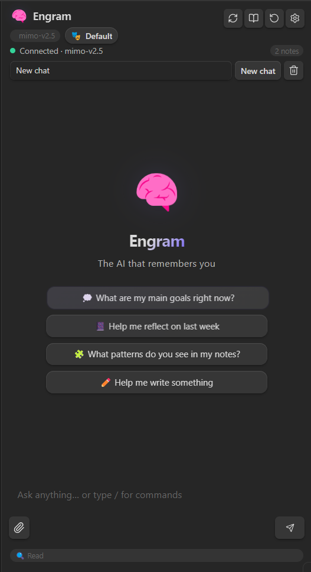

<h1 align="center">🧠 Engram for Obsidian</h1>

<p align="center">
  <strong>The AI that remembers you.</strong><br/>
  A sidebar chat for Obsidian with long-term memory, semantic vault search, and safe, scoped access to your notes.
</p>

<p align="center">
  
  
  
  
  
</p>

<p align="center">
  
</p>

<p align="center">
  <a href="#-features">Features</a> •
  <a href="#-how-it-works">How it works</a> •
  <a href="#-installation">Installation</a> •
  <a href="#-quick-start">Quick start</a> •
  <a href="#-commands">Commands</a> •
  <a href="#-troubleshooting">Troubleshooting</a>
</p>

---

## ✨ Features

| | Feature | What you get |
|---|---|---|
| 🧠 | **Long-term memory** | Engram keeps a plain Markdown memory file of facts about you and your projects, and brings it into every chat. |
| 🔍 | **Semantic search** | Finds notes by meaning, not just keywords. Ask about *"times I felt disconnected"* and it surfaces entries about numbness or withdrawal. |
| 🔌 | **Any model** | Works with local models (Ollama, LM Studio, llama.cpp) and cloud providers (OpenAI, Claude, Gemini, and more). |
| 🛠️ | **Works with your vault** | The AI can search, read, create, edit, move, and organize notes using built-in tools. |
| 🔒 | **You stay in control** | Limit which folders it sees, choose its edit permission, confirm risky changes, and undo AI edits. |
| 📄 | **PDF and image attachments** | Attach images or PDFs. PDF pages are rendered locally, with no external servers. |
| 💬 | **Chat history that syncs** | Each chat is saved as a file in your vault, so it syncs with Obsidian Sync, iCloud, Git, or Dropbox. |

<details>
<summary><strong>See all features</strong></summary>

### Memory
- Memory lives in `Intelligence/Memory.md` by default. It's a normal note you can read and edit.
- Run `/memory` to pull key facts from the current chat. You review them before they're saved.
- Engram can also save facts automatically, and skips duplicates.
- When memory exceeds its token budget (4,000 by default), the oldest entries are dropped. A `.bak` backup is kept before each write.

### Semantic search
- Embedding providers: **Ollama**, **OpenAI**, or any **OpenAI-compatible** `/v1/embeddings` endpoint (for example, llama.cpp).
- Click **Index Vault** in settings to build the index, with live progress.
- Notes used as context show up as clickable chips under your message.
- Changing the embedding model, provider, or URL clears the old index so stale vectors are never mixed in.

### Providers
- **Local:** Ollama, LM Studio, llama.cpp
- **Cloud:** OpenAI, Anthropic Claude, Google Gemini, DeepSeek, Groq, Mistral, xAI (Grok)
- **Aggregator:** OpenRouter (one key, many models)
- **Custom:** any OpenAI-compatible API
- Replies stream in, and requests go through Obsidian's own network API, so cloud providers don't hit CORS errors.
- Tool calling can be native, prompt-based (for models without tool support), or turned off.

### Safety
- **Scope:** an allowlist or denylist of folders, plus exclude patterns (`Private/**`, `*.secret.md` by default). Excluded files are never indexed, searched, or sent to the model.
- **Permissions:** one click on the chat footer badge switches between:
  - `🔍 Read`: search and read only
  - `✏️ Append`: can add to the end of notes
  - `⚠️ Full edit`: can create, overwrite, move, and delete
- **Confirmation:** destructive actions open a confirmation dialog first.
- **Undo panel:** review and revert changes the AI made.

### Interface
- Type `/` for commands and `@` to link a note as context.
- A token budget bar shows how much of the model's context window is in use.
- Personas let you switch between saved system prompts.

</details>

---

## ⚙️ How it works

```
 You ask a question
        │
        ▼
 ┌──────────────────────────────────────────────┐
 │ 1. Load your memory file                     │
 │ 2. Find related notes (semantic search)      │
 │ 3. Add @-mentioned notes and attachments     │
 └──────────────────────────────────────────────┘
        │
        ▼
   Your chosen model replies, and can use tools
   (search, read, edit…) within your permissions
        │
        ▼
 Answer streams in · used notes shown as chips · new facts saved to memory
```

Note content is wrapped in `[VAULT DATA START]` / `[VAULT DATA END]` markers, and the model is told to treat it as data, not instructions. This reduces the risk of prompt injection from text inside your notes.

---

## 📦 Installation

### Option 1: BRAT (recommended)
1. Install **BRAT** from Obsidian's Community Plugins.
2. Open BRAT settings → **Add Beta plugin**.
3. Paste `https://github.com/PixelAnay/Engram`.
4. Enable **Engram Chat** in Community Plugins.

### Option 2: Manual
1. Download `main.js`, `manifest.json`, and `styles.css` from the [latest release](https://github.com/PixelAnay/Engram/releases).
2. Put them in `<YourVault>/.obsidian/plugins/engram-chat/`.
3. Reload Obsidian and enable **Engram Chat**.

---

## 🚀 Quick start

### 1. Connect a model
Go to **Settings → Engram**, pick a provider, and enter a model name (plus an API key for cloud providers).

> 💡 **Free and local:** install [Ollama](https://ollama.com), run `ollama pull llama3`, and pick **Local — Ollama**.

### 2. Turn on semantic search (optional, recommended)

Pick an embedding provider:

<details>
<summary><strong>Ollama</strong> (easiest, free, local)</summary>

```bash
ollama pull nomic-embed-text
```
Ollama runs at `http://localhost:11434` by default.
</details>

<details>
<summary><strong>llama.cpp</strong> (full control, GPU)</summary>

Download a GGUF embedding model, then start the server in embedding mode:
```powershell
.\llama-server.exe -m "C:\path\to\model.gguf" --port 8080 --embedding
```
Check that it's running at `http://localhost:8080/v1/models`.
</details>

<details>
<summary><strong>OpenAI</strong></summary>

Use `text-embedding-3-small` with your OpenAI API key.
</details>

Then fill in **Settings → Engram → Semantic Search**:

| Setting | Example |
|---|---|
| Provider | `Ollama`, `OpenAI`, or `Custom` |
| Model | `nomic-embed-text` |
| Base URL | `http://localhost:11434` (Ollama) or `http://localhost:8080` (llama.cpp) |
| API key | OpenAI only |

### 3. Index your vault
Click **Index Vault** and wait for the *"Indexed N files"* notice. Run it again after adding many notes.

### 4. Chat
Click the 🧠 icon in the left ribbon and start talking. Semantic search runs automatically once the index is ready.

---

## ⌨️ Commands

**Slash commands** (type in the chat box)

| Command | Action |
|---|---|
| `/memory` | Save key facts from this chat to memory |
| `/forget` | Open the memory file to review or delete entries |
| `/persona` | Switch the active persona |
| `/export` | Export this chat to a vault note |
| `/clear` | Clear the current chat |
| `/scope` | Show which folders the AI can access |

**Command palette**

| Command | Action |
|---|---|
| Open Engram sidebar | Open the chat panel |
| Re-index vault | Rebuild the semantic search index |
| Open memory file | Open your memory note |
| Sync chat history from vault | Reload chats saved in the vault |

---

## 🔐 Privacy

- With local models and local embeddings, nothing leaves your machine.
- With cloud providers, only the chat, your memory, and the matched notes are sent to that provider.
- Embeddings and settings are stored in `.obsidian/plugins/engram-chat/data.json`.

> ⚠️ **API keys are stored in `data.json`.** Don't commit your `.obsidian` folder to a public Git repository.

---

## 🩺 Troubleshooting

<details>
<summary><strong>The AI doesn't seem to use my notes</strong></summary>

- Make sure indexing finished (check the file count in settings).
- Your embedding server must be running while you chat, not just while indexing.
- Look for note chips under your message. If they're there, the notes were sent to the model.
</details>

<details>
<summary><strong>Indexing fails</strong></summary>

Check the Base URL and that the embedding server is running. Engram tests the connection before indexing and shows an error if it can't connect.
</details>

<details>
<summary><strong><code>llama-server</code> is not recognized (Windows)</strong></summary>

Run `.\llama-server.exe` (with `.\` and `.exe`) from the folder that contains it, or add that folder to your `PATH`.
</details>

<details>
<summary><strong>"model output must contain either output text or tool calls"</strong></summary>

The model returned an empty reply. Try another model or a simpler question. For local models, check that the model is fully loaded and has enough VRAM.
</details>

<details>
<summary><strong>My index disappeared after a restart</strong></summary>

The index is saved between restarts. If it's gone, the embedding model, provider, or URL probably changed, which clears the index on purpose. Re-index once.
</details>

---

## 🧑‍💻 Development

```bash
git clone https://github.com/PixelAnay/Engram.git
cd Engram
npm install
npm run build      # type-check and bundle to main.js
```

To build and copy the plugin into a test vault:

```powershell
setx OBSIDIAN_VAULT_PATH "C:\Path\To\Your\Vault"   # once, then open a new terminal
npm run deploy
```

---

## 📄 License

[MIT](LICENSE) © PixelAnay
